# Factorial: what the app does

Factorial is the browser app of `process-improve`, at <https://factori.al/>. It plans a
designed experiment, takes its results, analyses them and says what to run next, in four
steps: Design, Run, Learn and Next. Python runs inside the browser tab, so a study never
reaches a server.

This document lists what the app does today. Use it to describe the app elsewhere. Three
rules keep it true:

- It holds what the app does as built from this commit, and nothing planned. What the app
  does not do is under [What it does not do](#what-it-does-not-do).
- A change to the app that a reader of the app would notice changes this document in the same
  pull request ([`CONTRIBUTING.md`](../CONTRIBUTING.md#the-browser-app-is-tested)).
- [`tests/web/page/test_features.py`](../tests/web/page/test_features.py) fails when a design,
  a chart, a process to practise on, a limit or a count below is not what the app has, or
  when a design the library makes is not listed with what the library and the app take for it.

The app's own page, [features.html](features.html), shows this document to its readers, so it
is written for them:

- **Plain words first.** Each point opens with what it means for the person using the app, as
  a sentence in bold that ends with its period.
  What only a statistician asks, or the person who looks after the computers, goes on an
  indented line under the point that starts with *Details:*. The page shows that line when
  it is asked for, and a button in each part opens every such line of that part.
- **Headings are the page's parts.** A `##` heading is a step of a study. A `###` heading is
  a part that folds, and the line in italics under it is what the fold says while closed.
- **A point can end with "Show me".** It is a link to `https://factori.al/?example=<name>&show=<part>`
  (or `?book=<name>`): the app opens that example at the part of its page with that id. On
  the page the link stays within the copy of the app it is served from.
- **A chart has its picture.** It is on a line of its own under the chart's point,
  ``, where the key is the chart's in `CHARTS` (`web/logic.js`). The
  page puts it above the point. [`CONTRIBUTING.md`](../CONTRIBUTING.md#the-browser-app-is-tested)
  says how the pictures are drawn again.

Counts marked "(Nov 2026)" come from the build of 14 November 2026 and only grow.

<!-- features.html shows what follows -->

## In one minute

- **Nothing to install.** Open a web page and start. No account, no cost, and the code is
  open source.
- **Your data stays on your device.** What you type and what you measure never leave your
  browser.
- **Works with no network.** After one visit the app opens and runs offline: in a plant, a
  lab or a plane.
- **16 designs.** One form makes them all, from a full factorial to optimal, space-filling and
  mixture designs, also when some settings cannot be run.
- **From a question to a recommendation.** Say what you want to learn. The app lists the
  designs that can answer it, analyses your results, finds the best settings, and says what
  to run next.
- **Plain words.** Findings are written as sentences from the numbers alone, with no language
  model: the same results give the same words.
- **17 charts.** Each opens large, saves as an image, and shows the Python that draws it. A
  run pointed at on one chart is marked on the others and in the run sheet.
- **Charts that are accurate and good to look at.** Factorial aims for both. Surfaces and
  maps are drawn in batlow, a Scientific colour map: a step in the colour is a step in the
  value, and it reads in grey and without telling red from green. Settings offers three more.
- **Nothing hidden.** Every step shows Python code that gives the same numbers. A study
  leaves as a workbook, a notebook, a report, a file or a link.
- **Checked against print.** The design catalog opens more than 1,000 published designs and
  experiments in the app. Where a source prints its results, the app lists them beside its
  own.

## Design

### Choose a design

*16 designs in one list, each for a kind of question.*

The design list holds 16 designs, in two groups: the six most used, then the rest, with the
three mixture designs under a heading of their own.

- **Full factorial (2-level).** For 1 to 7 factors. Every combination of low and high: the
  whole picture, for a few factors.
  - *Details:* Mixed levels with a categorical factor of 3 to 8 levels.
- **Fractional factorial (2-level).** For 3 to 24 factors. A chosen part of the full factorial:
  many factors in few runs, at the price of some effects being mixed together.
  - *Details:* Resolution III, IV or V; minimum aberration; chosen on a grid of runs against
    factors.
- **Plackett-Burman screening.** For 2 to 40 factors. Finds which of many factors matter, in
  very few runs.
- **Taguchi orthogonal array.** For 2 to 40 factors. A standard array for the effect of each
  factor on its own.
  - *Details:* Each numeric factor at two levels or at three.
- **Definitive screening (DSD).** For 3 to 40 factors. Screens many factors at three levels, so
  an effect that curves shows too.
- **OMARS (three levels, runs you choose).** For 3 to 5 factors. As a definitive screening
  design, in the number of runs you choose: more runs sharpen the curves and the interactions.
  - *Details:* Up to 41 runs.
- **Box-Behnken.** For 3 to 7 factors. For a response that curves, to find its best point, with
  no run at the extreme corners.
- **Central composite (CCD).** For 2 to 7 factors. For a response that curves, to find its best
  point: a factorial with runs added along each factor and at the center.
  - *Details:* Face-centred, rotatable, orthogonal, or an axial distance you type.
- **D-optimal.** For 2 to 40 factors. The runs that pin down your model's effects best, for the
  number of runs you can afford, inside any limits on the settings.
  - *Details:* For a model of up to 91 coefficients: any model in up to 12 factors, and the
    main effects in up to 40. The three optimal designs take a categorical factor of 2 to 8
    levels beside the numeric ones, and choose each run's level with its settings.
- **I-optimal.** For 2 to 40 factors. The runs that predict best across the ranges, for the
  number of runs you can afford, inside any limits on the settings.
  - *Details:* For a model of up to 91 coefficients, as the D-optimal design is.
- **A-optimal.** For 2 to 40 factors. The runs that know every effect of your model about
  equally well, for the number of runs you can afford, inside any limits on the settings.
  - *Details:* For a model of up to 91 coefficients, as the D-optimal design is.
- **Space-filling (Latin hypercube).** For 2 to 8 factors. Runs spread evenly through the
  ranges, for a response whose shape is unknown, or for a machine-learning model.
  - *Details:* Maximin; up to 200 runs.
- **Space-filling (Sobol sequence).** For 2 to 8 factors. Runs spread through the ranges so
  that runs added later fall between the first.
  - *Details:* Up to 200 runs.
- **Simplex lattice (mixture).** For 3 to 6 factors. For a recipe whose parts add up to a
  whole: each part alone and the even blends of them.
  - *Details:* Degree 1 or 2.
- **Simplex centroid (mixture).** For 3 or 4 factors. For a recipe: every blend of equal parts.
- **Extreme vertices (mixture with bounds).** For 3 to 6 factors. For a recipe in which each
  part has a least and a most.
  - *Details:* A lower and an upper proportion for each component.

Also:

- **A design you have already.** The runs of a design the app did not make, such as one a
  book prints or a table of your own, are taken as they are and analysed.
  - *Details:* "Runs as given", in their order and their own units. The app analyses them
    with the largest model they estimate in full. Runs that form a regular two-level fraction
    state its resolution and defining relation.
- **One factor on its own.** Two or more levels compared, with enough runs for a real
  difference to be found.
  - *Details:* Sized by the power of the test.
- **Options to add.** Runs at the center, repeats of every run (up to 10), and runs grouped
  into blocks such as days or batches (up to 8).
  - *Details:* Also the model an optimal design is made for, and the number of runs where the
    design takes one.
- **A fair run order.** The runs come in a random order, so that a drift during the day is
  not taken for an effect.
  - *Details:* From a seed of the study's own, named in the report and the code.
- **What you are getting.** For each design the app says how many runs it takes, how many are
  spare, and which effects it cannot tell apart.
  [Show me](https://factori.al/?book=bioreactor-half-fraction&show=design-summary)
  - *Details:* Its runs and spare runs, its resolution and defining relation, its aliases, and
    what its blocks take.

### Plan a study

*From what you want to learn to a run sheet, with the trade-offs said.*

- **Start from the question.** Say what you measure (its name, its units, and a goal: maximise,
  minimise, hit a target, or just learn), what might change it, and what you want to learn.
  [Show me](https://factori.al/?example=worked&show=response-card)
  - *Details:* Design reads the question back as one sentence over the form: "Find the settings
    of Temperature, Pressure and Flow that give the highest Yield." With no goal it reads
    "Learn how ... change Yield", and a mixture's settings are a blend.
- **The ladder: start small and add runs.** For two to five numeric factors, the designs are
  steps on one line: half the corners, every corner, center points, then axial points. Each
  step says its runs, the runs it adds, and what they let you learn. Press one to plan it.
  - *Details:* For three factors the steps are 4, 8, 11 and 17 runs. Each step holds the
    runs of the one before; the last is a face-centered central composite design. A press
    sets the design and the aim. Two factors have no half. A categorical factor, a mixture,
    or six factors or more keep the list of designs.
- **Do a practice round first.** One press in Design makes the run sheet, fills it with
  results the app makes up from a process whose true behaviour is known, and opens Learn on
  them. You see what the plan can and cannot tell you before a run is spent.
  - *Details:* Learn says it is a practice round and that no run has been made. One press
    clears the made-up results and leads to the run sheet, for the real ones. A result you
    type ends the note.
- **Say what you know already, if you like.** The typical value, how much results vary from
  run to run, and the smallest change worth finding. The app then says how likely each
  design is to find that change.
  - *Details:* They give each design's power.
- **Up to 5 responses.** Each has its own units and goal.
- **Numbers and categories.** A factor can be a number, such as a temperature, or a
  category, such as a supplier. A categorical factor has 2 to 8 levels of any text, shown as
  chips to type, paste, remove and reorder.
- **Four aims to choose from.** Find which factors matter; see how they act together; see
  where an effect curves; or map the whole response to find its best point.
- **The designs that fit your question.** As you type, the app makes every design that fits and
  lists each with its runs and what it stands out for. It suggests one and says why. A design
  left out says why. [Show me](https://factori.al/?example=worked&show=step-plan)
  - *Details:* Each is listed with its runs, spare runs and power. The app picks the fewest
    runs that leave three or more spare.
- **A long search waits for you.** A design that takes time to find says how long, up to
  about 2 minutes, and starts when you ask for it. You can stop it.
  - *Details:* An optimal design whose search is expected to take 5 seconds or more. The time
    follows the size of its model and the number of factors, not the number of runs.
- **Compare designs side by side.** What each design costs in runs and what it gives in
  precision. A switch sets a design aside.
  - *Details:* Nine measures of each design (precision of the coefficients and of the
    predictions, correlation between terms, power), fraction-of-design-space curves on one
    chart, and a correlation map of each design.
- **Settings that cannot be run.** Say which combinations are out of bounds, such as a high
  pressure at a high temperature, and the app plans around them. It says what each limit
  rules out and how much of the ranges is left, and draws the settings that can be run.
  - *Details:* Up to 8 inequalities in the factors' own units, such as `T + 25*P <= 250`. A
    limit can also be proposed from the corners you mark as not runnable. The picture is
    drawn for each pair of factors. A limit on numeric factors holds at every level of a
    categorical factor beside them.
- **A limit for one level.** A raw material that can only be dosed up to 1.5 %, or a catalyst
  that cannot run above a temperature: a limit that holds at one level of a categorical
  factor and not at the others. It is built from five choices, not typed. Ranges that do not
  overlap from level to level are two such limits.
  - *Details:* For the three optimal designs. The panel, its picture and its corners are
    shown for one combination of levels at a time, which the reader picks. Learn keeps to the
    limit of the level it chooses: the best settings, a target, a specification, the
    trade-offs and the settings tried in What if. Two levels that are never run together are
    typed, as `not (A == 'x' and B == 'y')`. A comparison of designs scores them over the
    whole ranges when a study has such a limit.
- **A factor that is hard to change.** An oven's temperature, or a tank's fill: tick the
  factor, and the design sets it once for a group of runs, a whole plot, and not afresh for
  every run. The run sheet lists the runs one whole plot after another, and Learn judges
  each term against the spread it meets, so the factor does not look more certain than it is.
  - *Details:* A split-plot design, for the three optimal designs, with no limits on the
    settings and no blocks. Learn fits the spread from whole plot to whole plot and from run
    to run (REML) for the coefficients' errors and p-values, and shows no ANOVA table or
    lack-of-fit test, which have one error. The charts, the best settings and the predictions
    come from the ordinary fit. Learn adds no runs to such a design, and practice results
    have no spread between whole plots. A study with such a factor is saved in study
    format 11.
- **Know what your runs can tell apart.** Before a run is made, the app names the effects that
  these runs cannot separate from each other.
  [Show me](https://factori.al/?book=bioreactor-half-fraction&show=correlation)
  - *Details:* A correlation map of the study's own runs, with sentences that name each
    aliased or correlated pair of terms. The map runs from -1 to +1: blue for two terms that
    move opposite ways, red for two that move together, and the colour of the page for
    neither, with a key beside it.
- **Experiments like yours.** The plan beside what others in your field have published.
- **Room for a large study.** Up to 40 factors.
  - *Details:* Interactions are modelled for up to 12.
- **Rename freely.** A new name or unit for a factor or response reaches the run sheet, the
  equations, the charts and the code, without making the runs again.

## Run

### Run it

*A run sheet to fill in: type, paste or upload your results.*

- **A run sheet in the order to run it.** It has a column for each response, and its columns
  sort. [Show me](https://factori.al/?example=worked&show=step-run)
  - *Details:* The order is the randomised one.
- **Type, paste or upload your results.** A block pasted from a spreadsheet fills the sheet,
  and a workbook filled in elsewhere is read back.
  - *Details:* A pasted block is matched by run number when it has one, with decimal commas
    read. The workbook is an .xlsx file.
- **No need to wait for every run.** The app analyses the runs that have a result.
  - *Details:* Once every run has its result, Run says so at its top, with the way to Learn.
- **Your results do not leave the page without a question.** Making the run sheet again keeps
  the sheet and its results when the design is unchanged. When the design has changed, the
  app asks first: a new run sheet is a new study, and this one stays in Your studies.
  - *Details:* Practice results are made again without a question, and simulating fills only
    the runs that have no result of your own.
- **One run at a time.** A card on Run shows the run to make now: its settings in large type,
  a box for its result, and "Next run". It is open at first on a phone, for work at the
  bench; the whole run sheet stays under it.
  - *Details:* The card opens at the first run still to make. Its boxes are the run sheet's
    own. The app remembers whether you left it open.
- **A run that failed.** Tick "This run failed" on the card. The run stays on the run sheet,
  marked, with no result. The fit goes without it, and the next step does not wait for it.
  - *Details:* The count of runs goes without it too. Untick it to make the run again.
- **A run that left the plan.** Press a setting on the run sheet and type the setting the run
  was really made at. The model is fitted on it, and the sheet says which runs left the plan.
  - *Details:* For numeric factors; a mixture's proportions and a categorical factor's level
    stay as planned. The planned setting is kept with the study, and one press puts every
    run back on the plan. A study with such a run is saved in study format 10.
- **Practise before you spend a run.** Simulated results from a process whose true behaviour is
  known, to see whether the analysis finds it. You set the noise, simulate again for new noise,
  and show the true process when you want it.
  [Show me](https://factori.al/?example=worked&show=panel-simulate)
  - *Details:* Six processes with a known true model: A typical process, Main effects only, An
    interaction, A maximum inside the ranges, Nothing active, and A random process. A mixture
    has one of its own (a synergy and an antagonism).
- **A whole curve as a result.** A response that is a curve at each run, such as a spectrum
  or a colour over time, pasted under the run sheet.
- **Runs added later join the run sheet.** They are a block of their own, and confirmation runs
  go at its end.
- **A changed plan is flagged.** The run sheet is marked as out of date, with one button to
  make the new one and one to put the design back.

## Learn

### Understand the results

*What matters, by how much, the best settings, and what to run next.*

#### What the results say

- **The answer first.** Learn opens with where to run and what to expect there: "Run at
  Temperature = 200 degC, Pressure = 1 bar and Flow = 18.04 L/min. The model predicts the
  highest Yield there: 68.25% (95% confidence interval for the mean: 66.17 to 70.33%)." The
  evidence follows it.
  [Show me](https://factori.al/?example=worked&show=answer)
  - *Details:* The numbers are those of the best settings further down. With no goal to
    reach, the answer is the factor that matters most. The report opens with the same answer.
    Beside the answer, where it sits: a line for each numeric factor, from the low end of its
    range to the high, with the setting as a point on it. For two or three numeric factors
    the settings are also a filled point on a square or a cube, among a ring for each setting
    already run. On a phone the lines come first.
- **Checks of the answer.** Under it, whether to rely on it: the fit, runs that stand apart,
  whether the repeated runs agree with the model, and whether the settings are within reach
  of the runs. Each says its verdict and opens to a sentence and its statistic.
  [Show me](https://factori.al/?example=worked&show=checks)
  - *Details:* A check to look at is open already. What the runs cannot tell is said so: a
    model that uses every run, or a study with no repeated runs. Each check leads to its
    evidence on the page, and the report holds them all open.
- **The findings in sentences, each beside its picture.** Which factor matters most and by
  how much in its own units, which effects are real, which terms show no sign of an effect,
  which effects depend on another factor, where the response curves, how well the model
  fits, and which runs to look at again. A small picture stands before the words it shows: a
  slope for a factor's own effect, a curve where the response curves, two lines for a pair
  of factors that act together.
  [Show me](https://factori.al/?example=worked&show=analysis)
  - *Details:* The pictures share one scale, so a steeper line is a larger effect. Each is
    drawn from the fitted coefficients over the ranges you set, and is said in words to a
    reader who does not see it. "Show the numbers" puts each finding's coefficient, its 95%
    interval and its p-value under it. The report holds the pictures too.
- **Choose how much the model holds.** As designed, the factors on their own, the factors
  and how pairs of them act together, or curves as well.
  - *Details:* As designed, main effects, main effects and two-factor interactions, or the
    full quadratic. The list says "Your terms" while the model is one you built term by
    term.
- **The model and its tables, a press away.** The equation, the fit, the table of the
  effects, the analysis of variance and each run are under one heading, "For the
  statistician". Learn reads in sentences until you open it.
  - *Details:* The heading stays as you leave it, open or closed, for the next fit and the
    next visit. The report holds every table either way.
- **The model as terms to press.** Under "For the statistician", every term the model may
  hold is there, with the model's own ticked. One press takes a term out or puts it in, and
  the answer, its checks and the findings follow.
  - *Details:* Main effects, interactions of up to three factors, and squares. A term put in
    brings the main effects it is made of; a term taken out takes nothing with it, so a
    factor nested in another can be written. Terms the design cannot tell apart are one
    term, written "A·B = C·D". "As designed" goes back to the design's own model, and "Keep
    the clear terms" fits the terms the results support at once. A model that cannot be
    fitted keeps its terms on show, so a term can be put back.
- **The size of each effect, and how sure it is.** A table of the effects, the surest
  first. With simulated results each stands beside its true value.
  - *Details:* Coefficients with 95% intervals and p-values, ordered by p-value.
- **How well the model fits.** The app also says whether repeated runs show that it misses
  something.
  - *Details:* Analysis of variance, a lack-of-fit test when runs are repeated, R², adjusted
    R², predicted R² and the residual degrees of freedom.
- **Results that span a wide range.** When the results call for it, the app offers to
  analyse the log, the square root or the inverse of the response, and gives its answers in
  the response's own units.
  - *Details:* The response as measured, or its log, square root or inverse. Box-Cox's
    interval offers the transform.
- **Effects that cannot be told apart are shown as one.** Neither is given the credit alone.
  - *Details:* Aliased terms are estimated once, as their chain (`T + P·F`).
- **A design with no spare runs is still judged.**
  [Show me](https://factori.al/?book=saturated-screening&show=analysis)
  - *Details:* Saturated designs are judged with Lenth's method.
- **Days and batches are allowed for.** A difference between blocks is taken out before the
  factors are judged. [Show me](https://factori.al/?book=side-product&show=analysis)
  - *Details:* Blocks are fitted as a fixed effect. A term the blocks take is left out, with
    a note.
- **Categories of three levels or more.** Each level is compared, and the factor is judged
  as a whole.
  - *Details:* Fitted as a contrast for each level and tested as one source. A factor nested
    in another is fitted within it.
- **A warning when effects overlap.** When two effects move together in your runs, the app
  says that neither is known well.
  - *Details:* Each coefficient's variance inflation factor, with a note when one is above 5.

#### Checking the fit

- **Each run, as the model sees it.** What the model expected of each run, and how far the
  result was from it. A run that stands apart is marked.
  - *Details:* Fitted value, residual, leverage and Cook's distance. A run is marked by the
    Bonferroni outlier test.
- **Set a doubtful run aside.** The model is fitted without it. The run keeps its result,
  and Learn, the report and the code all say it was left out.
- **Simplify the model.** The app proposes the terms worth keeping. Nothing is fitted until
  you accept, and the app then says the terms were picked from the same results. The offer
  stands with the terms that show no sign of an effect, in what the results say. "Keep the
  clear terms", beside the model's terms, does the same in one press.
  - *Details:* Stepwise selection by AICc that keeps an interaction only with both its main
    effects.
- **How steady repeated runs are.** Where a setting was run more than once: its average and
  its spread.
  - *Details:* Mean, standard deviation, ln s and the signal-to-noise ratio at each setting,
    a response table, and the adjustment factor for a target.

#### One factor on its own

- **Two levels.** The difference between them and how sure it is, tested four ways.
  - *Details:* The difference and its interval; the t-test, Welch's t-test, a randomization
    test and Wilcoxon's rank-sum test.
- **Paired runs.** For example, before and after on the same unit.
  - *Details:* The paired t-test, a randomization test and Wilcoxon's signed-rank test.
- **Three levels or more.** Which levels differ from which, and from a reference level.
  - *Details:* One-way analysis of variance, Tukey's and Dunnett's intervals, Bartlett's test
    and the Kruskal-Wallis test.

#### Recipes (mixtures)

- **How the parts of a recipe act together.** Which parts help each other, which work
  against each other, and what each part does as its share grows.
  - *Details:* Scheffé models: linear, quadratic or special cubic blending, with the
    mixture's analysis of variance and each component's effect along its Cox direction.
- **The best blend.** It is searched for over the blends the bounds allow.

#### From the results to a decision

- **One card answers where to run.** The dials and the map of What if set the factors. Under
  them you choose what the settings are for: the best for your goal, a target to hit, or a
  window to stay in. That goal's settings are found under the dials.
  [Show me](https://factori.al/?example=worked&show=where)
  - *Details:* A goal is offered when the study has what it needs: a response with no goal
    has no best settings. A link to a part of a goal chooses that goal. The report holds
    every goal's part, whichever is on show.
- **The best settings for your goal.** They are inside the ranges and the limits, with what to
  expect there and how far a single run may fall from it. The app warns when the answer leans
  on the model beyond the runs, and says how tightly to hold each factor.
  [Show me](https://factori.al/?example=worked&show=best)
  - *Details:* The prediction with its 95% confidence and prediction intervals.
- **More than one goal at once.** With two or more responses, the settings that serve them
  best together. You set each response's acceptable range and its importance, and a picture
  shows where every response is acceptable.
  - *Details:* The settings of the best overall desirability, with each response's
    acceptable range, importance and shape to edit. For a mixture of four components or more
    the picture is over three of them, the others held at the balanced blend.
- **What one goal costs another.** A chart puts one response against another, with thousands
  of settings tried on the models: you see how much of one must be given up for the other.
  Colour the points by a third response, type a limit on any response to keep only the
  settings that meet it, and press a point to choose its settings.
  - *Details:* 2,000 settings drawn evenly from the ranges the limits allow, each categorical
    factor at the balanced settings' level, or at another level you pick above the chart, which
    then has no star for the balanced settings. A line joins the settings no other betters on
    both responses; a paler point is further from the runs than any run lies, by its leverage.
    Settings chosen move the what-if panel there and can be tested with confirmation runs.
    Other bests of the search within 5% of the balanced settings' overall desirability are
    listed. A mixture's chart is of 2,000 blends drawn evenly from those its bounds allow.
    The chart shows its Python, but a mixture's. The study keeps the chart's axes, colour, limits,
    levels and the settings chosen, in study format 14, and the report holds the chart and
    the settings chosen.
- **What if.** A dial for each factor: a picture of the response against that factor, with
  the others where you set them, over a slider and a box for its value. Drag on a picture,
  move the slider or type a value, and each response's prediction follows at once. Settings
  can be kept with the study under a name.
  [Show me](https://factori.al/?example=worked&show=what-if)
  - *Details:* Each picture has the 95% confidence band, and its line is dashed where the
    settings lie beyond the runs. The pictures share one scale, so a steeper line is a larger
    effect, and the scale holds still while you drag. A factor with levels has a dot for each.
    With several responses each has its row of pictures, on its own scale, and the table
    under them has every response with its intervals and its leverage. The Python gives the
    profiles of the response Learn shows.
- **A map beside the dials.** The response over two factors, with the others where the dials
  have them. Press or drag on it to set both factors at once. It marks where the dials are,
  stars the best settings, and fades where the settings lie beyond the runs.
  - *Details:* On a laptop the dials and the map are in view together. The two factors are
    those you gave the response surface among the charts, else the first two numeric ones.
    The star is drawn when the map passes through the best settings. On a phone a tap sets
    both factors, and an up or down swipe still scrolls the page. Its window shows the Python
    that draws the same surface.
- **A prediction as 20 runs.** Under the dials, each response is drawn as 20 runs you might
  get at those settings, each as likely as the next. A run inside the response's window is
  filled, and one outside it is a ring.
  - *Details:* The least and the greatest of the 20 are the two ends of the 95% prediction
    interval in the table beside them. The dots pile up where a run is likelier. A model
    with no run left to estimate the noise has no runs to draw.
- **Kept settings, side by side.** Settings kept under a name sit in one table: a row each,
  with every factor's setting and every response as predicted there, over its 95%
  prediction interval.
  - *Details:* A row puts its settings back on the dials, which then give every number of
    them, adds confirmation runs there, or is deleted. Settings past a limit, or outside a
    range edited since, say so in their row. The report holds the table.
- **A target curve.** For a curve response, the settings whose predicted curve comes closest.
- **Settings that give a target.** Type what a response should be, or what several should
  be, or pick a run to match. The app runs the models backwards and gives the settings, with
  each response's target beside what the models predict there.
  [Show me](https://factori.al/?example=worked&show=target)
  - *Details:* 20,000 settings tried on the models, inside the limits and at every
    combination of the categorical factors' levels, up to 400 of them. Settings give a target when the response is predicted within 2% of
    the range of its results from it. Of those, the answer is the one nearest the center of
    the ranges, moved by least squares to meet the targets exactly where the models can. The
    app says when no setting gives the targets, and when the settings lie beyond the runs. A
    chart draws each response's line of settings over two factors of your choice, with the
    runs. The settings go to the what-if panel, or are tested with confirmation runs. One
    factor can be solved for from the others, with the settings around it at which the 95%
    confidence interval of the prediction still holds the target; a button sets the factor
    there under What if. The section and its chart show their Python. The targets typed are
    kept with the study, in this browser, in its link and in its file; the settings are found
    again when it opens. The report holds the settings, the chart and the factor solved for.
    For a mixture the answer is a blend: 20,000 blends drawn evenly from those the bounds
    allow, the one nearest their middle that gives the targets, each component's proportion
    with where it lies between its bounds, and the blend weighed out for confirmation runs.
    Three components are drawn over their triangle; four or more over three of them, the
    others held at the blend found. A mixture has no factor to solve for
    alone. Its section shows its Python.
- **Settings that meet a specification.** Type the window a response must fall in, or the
  windows of several, either end or both. The app says what share of the settings the models
  put inside every window, and how surely one new run there meets them.
  [Show me](https://factori.al/?example=worked&show=window)
  - *Details:* 20,000 settings judged inside the limits, with the library's
    `feasible_region`. The chance that one new run meets a window is the share of its
    predictive distribution inside it, Student's t about the prediction by the standard
    error of a new observation. With several windows the chances are joined with the
    correlation of the fits' residuals, since responses measured on one run often miss
    together, when the runs leave five or more past the largest model's terms, and the
    doubt in that correlation, from so few runs, is averaged over; with fewer
    they are multiplied, as for independent errors. The app gives the share of
    the settings at which that chance is 50% or more and 90% or more, and the settings at
    which it is highest, which go to the what-if panel or get confirmation runs. A chart
    shades the settings that meet the windows over two factors of your choice, the others
    where What if has them, with a line for each chance and the runs. A study with a
    categorical factor is judged at the level What if has, and a table beside it gives the
    share and the highest chance at each of the other levels: at up to 48 combinations of
    levels, with a note when a study has more. No chance is given
    when the fit leaves no run to estimate the noise. The section and its chart show their
    Python. The windows typed are kept with the study, as the targets are, and the report
    holds what they gave and the chart. For a mixture the share and the chances are of the
    blends the bounds allow, and the surest blend is given, with confirmation runs at it.
    Three components are drawn over their triangle, four or more over three of them with the
    others held at the surest blend: the blends that meet the windows shaded,
    a line for each chance reached, and a star at the surest blend. Its section shows its
    Python: the blends are drawn from the region the bounds allow.
- **Check the answer.** One button adds three confirmation runs at the settings found, and the
  app judges them when their results are in.
  [Show me](https://factori.al/?example=worked&show=confirm)

#### Data you have already

- **Analyse data you have.** Paste a table, or open a .csv or .xlsx file, of an experiment
  run elsewhere or of a process's records. The app guesses the factors and the responses,
  reads units from the headings, and lets you correct it. It then says which factors moved
  together and what unplanned runs cannot show.
- **Bring a design from JMP, Minitab, Design-Expert or MODDE.** Export it as .csv or .xlsx and
  open it here. The app knows each program by the columns it writes, says which program it was,
  and leaves out the columns that only number and code the runs (Minitab's StdOrder, RunOrder
  and CenterPt; JMP's Pattern; Design-Expert's Std, Run and Space Type; MODDE's Exp No, Exp
  Name, Run Order and Incl/Excl). A block column is kept as a factor.
- **Compare with the published answer.** A study opened from the catalog lists each number
  its source prints beside the app's own, and whether they agree.

### See it: 17 charts

*Each opens large, saves as an image, and shows the Python that draws it.*

#### The 17 charts

Nine charts come with the analysis. Eight more are one press away, under More charts.

- **Coefficients.** How large each effect is, and how sure. Every fit has it, and it switches
  to the book's Pareto plot, and to the effects in the response's own units.
  [Show me](https://factori.al/?example=worked&show=charts)
  - *Details:* The view "Effects" draws how far each term moves the response over the
    ranges: twice a coefficient, or the coefficient of a square. A band marks changes smaller
    than the one you said is worth finding, so an effect can be seen to be real and still too
    small to matter. A fit on a transform's scale, and a mixture, have no such view.
  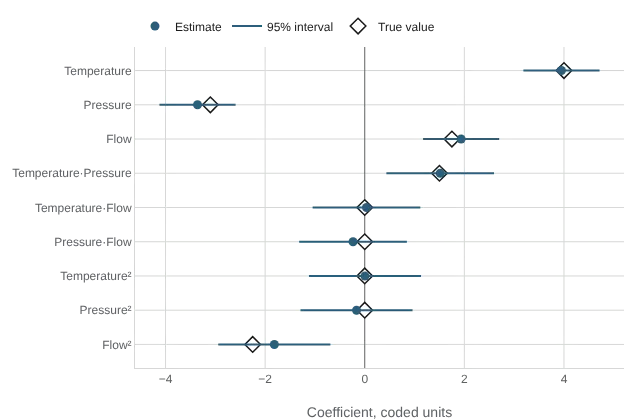
- **The runs at each level.** The results at each level, side by side, for a study of one
  factor.
  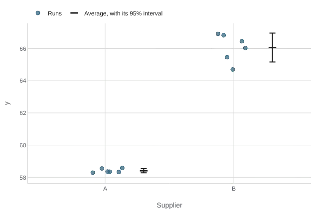
- **Fitted response surface.** A map of the response over two factors of your choice, the
  others held at the best settings.
  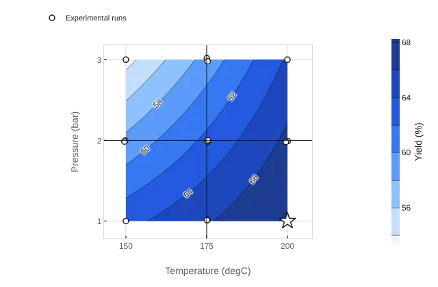
- **True response surface.** With simulated results: the true process, on the fitted
  surface's colour scale.
  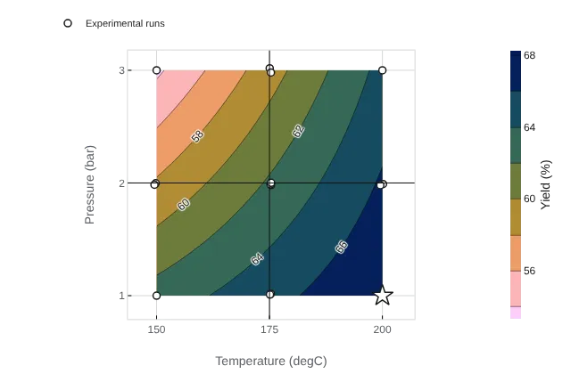
- **Fitted response over the blends.** For a mixture of three components: the response at
  every blend. For four or more: over three of them you pick, at first the three that move
  the response most, the others held at the best blend once there is one.
  - *Details:* The three share what the held components leave, so the triangle reads in the
    recipe's own proportions; its caption names what is held. Its runs are not drawn, since a
    run is on that triangle only if it holds the others at the same shares.
  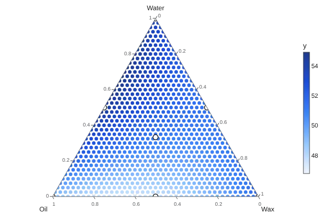
- **True response over the blends.** For a mixture with simulated results.
  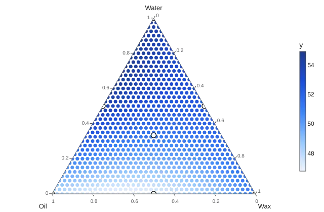
- **Fitted response along each Cox direction.** For a mixture of four components or more:
  what each part does as its share grows.
  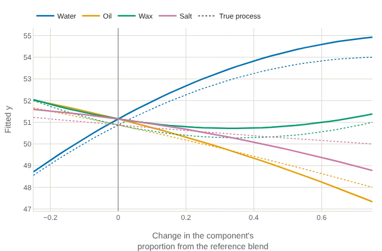
- **Residuals against fitted values.** What the model leaves unexplained, to see whether it
  misses a pattern. Every fit has it.
  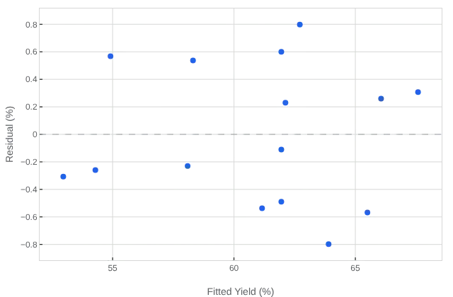
- **Half-normal plot of the effects.** For a saturated two-level design: the effects that stand
  out from the noise. [Show me](https://factori.al/?book=saturated-screening&show=charts)
  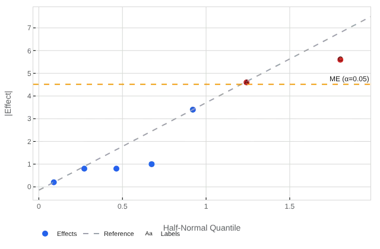
- **Each factor's effect on the prediction.** One line for each factor, with a 95% band.
  *More charts.*
  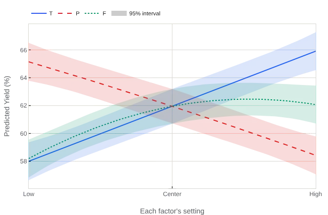
- **Average result at each setting.** *More charts.*
  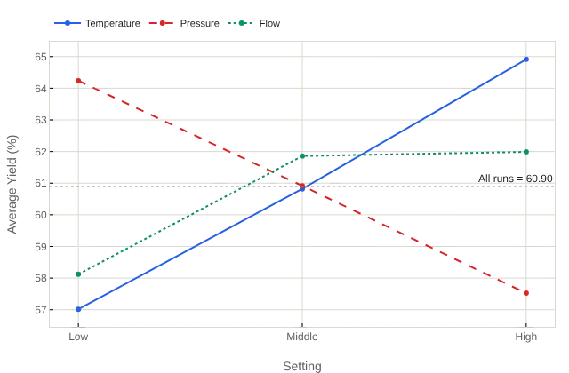
- **Interaction of the two factors.** Whether one factor's effect depends on the other.
  *More charts.*
  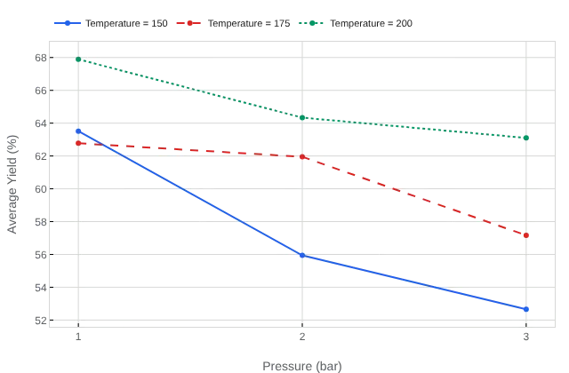
- **Fitted response surface, in three dimensions.** *More charts.*
  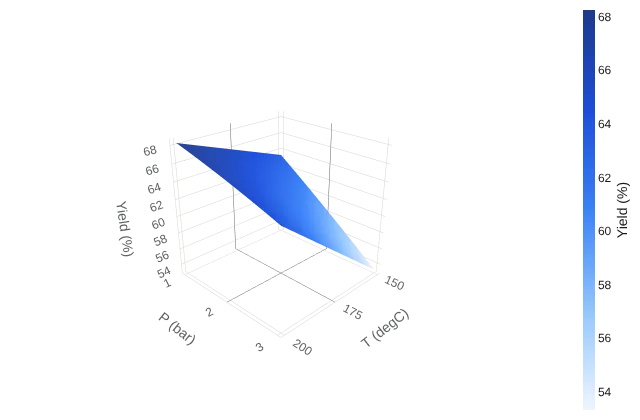
- **Predictions at the corners.** *More charts.*
  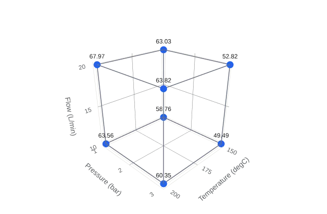
- **Residuals against the normal distribution.** *More charts.*
  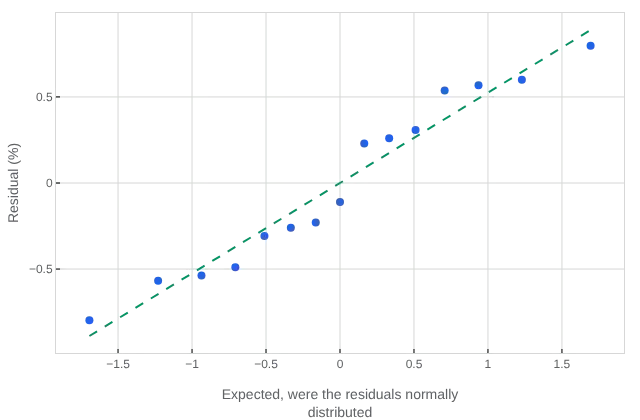
- **Residuals in the order the runs were made.** To see a drift over time. *More charts.*
  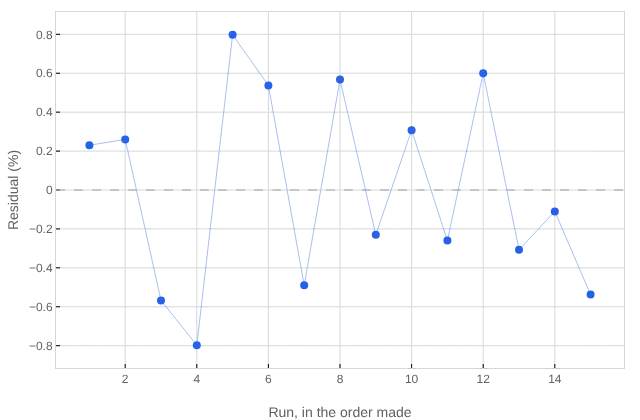
- **Where the predictions are least certain.** *More charts.*
  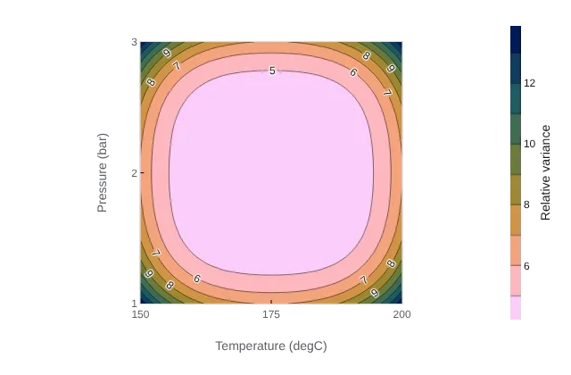

Also:

- **Other pictures.** The settings you can run; how the designs compare; which effects your
  runs can tell apart; how tightly to hold each factor; where every response is acceptable;
  and a predicted curve with its uncertainty.
  - *Details:* The settings for each pair of factors; the fraction-of-design-space curves and
    correlation maps of the designs compared; the correlation map of the study's runs; and a
    predicted curve with its 95% bands.

#### Looking closely

- **Open any figure large.** Expand opens a figure over the page, in a shape you choose or
  drag it to, and keeps that shape for the next visit.
  - *Details:* The shapes are 16:9, 4:3, square or all the room, or the size its corner is
    dragged to, with a mouse, a finger or the arrow keys. A drag across the figure zooms into
    that part of it, or turns a figure in three dimensions; Plotly's tools move it and put it
    back. On a touch screen a drag on a card scrolls the page, except on a figure in three
    dimensions, which it turns.
- **Step through the figures.** Use the window's arrows or the left and right keys.
- **Save or copy a figure.** Take an image file, or an image on the clipboard to paste, for a
  report or a slide.
  - *Details:* A PNG or an SVG in the shape shown, on white under its title. An image saved
    from a dark page has the light theme's colours.
- **The Python that draws it.** Each of the 17 charts shows code that runs as it is, and so
  do the other figures.
  - *Details:* The library's own call for the eleven charts the library draws, and Plotly's
    for the six the page draws itself. The other figures with code are the Pareto plot of the
    coefficients and their effects, how tightly to hold each factor, the overlay of the acceptable ranges, the
    what-if curve, the FDS plot and the correlation maps. A mixture's triangle overlay and its
    components' moves show none yet.
- **One run, marked everywhere.** Rest on a run on a chart or in a table and it is ringed on
  every chart that draws the runs and shaded in the run sheet. A press or a tap keeps it;
  Escape lets it go.
- **Reading a chart.** Resting on a point names its run. A chart of several lines reads every
  line at one setting together. Each factor's effect is read with its interval.

#### Drawn to be read

- Axes and titles are in your words and units. A long title wraps.
- Every chart fits its card and is drawn again when its room changes.
- Light and dark themes. On a dark page a surface starts as dark as the page, with no glare.
- Colours that are even to the eye. Factorial aims for charts that are scientifically
  accurate and good to look at, so surfaces and maps are drawn in batlow, a Scientific
  colour map (Crameri, 2018). A step in the colour is a step in the value, with no band that
  the eye takes for an edge. It reads in grey, and without telling red from green. The
  pictures of the response surface on this page show it. Settings offers devon, la jolla and
  grey as well, and flips any of them.
- The numbers on a surface's lines have a halo, so they read on every band.
- Lines differ by pattern as well as colour. A run's marker reads on every colour of a surface.
- Each chart is one named picture to a screen reader, beside a table that holds its numbers.
- **A chart stays with you.** No chart offers to send itself to another company's servers.
  - *Details:* Plotly's.

### Take it with you

*A workbook, a notebook, a report, a file or a link.*

- **See the code behind every step.** Each step shows a Python script that runs as it is and
  gives the page's numbers, so that anyone can repeat your analysis without the app.
  [Show me](https://factori.al/?example=worked&show=py-analyse)
  - *Details:* A script of `process-improve` calls for the design, the comparison, the
    analysis, the best settings, the balance, the predictions and each figure. Tests run the
    code and compare.
- **A workbook for the lab.** The run sheet as a spreadsheet to fill in, which the app reads
  back.
  - *Details:* An .xlsx file. Two downloads of one study are the same file. It also keeps the
    targets and the specification limits typed in Learn, so they come back with the workbook.
- **Run sheet (.csv).** It opens in any spreadsheet or program.
- **A notebook.** It holds the study's code, with a cell that draws each figure of the
  analysis.
  - *Details:* An .ipynb file.
- **A report to hand over.** One page that needs nothing else: the question, the design, the
  results, the analysis with its charts, the best settings, the next step and the code.
  - *Details:* An .html file. A stamp gives the seed, a fingerprint of the study (its
    SHA-256) and a link that opens the same study. It ends with "Terms used": each word the
    report used that the page defines, with its meaning, since paper has no word to press.
    The software versions are at its foot.
- **A link to a study.** It carries the results or leaves them out. Whoever opens it has the
  same study, and the study in the link reaches no server.
  - *Details:* The study is packed after the `#`, which a browser sends to no server.
- **Move your studies.** One study or all of them as a file, to take to another browser or
  another computer.
  - *Details:* The study file (.json) is plain JSON and carries a SHA-256 of each study. A
    study that builds on another names it there, so a file of both holds the campaign.
- **Old studies keep opening.** A link or a file saved by an earlier version opens in a
  later one.
  - *Details:* An earlier version refuses a newer study in a sentence, and opens no part of
    it. From study format 12 on, a version keeps a setting it does not know and takes no
    notice of it, so a later setting that only changes how a study looks opens in it.
- **Share.** It hands a study to the device's share sheet where the browser has one.
- **Examples by name.** The book's 19 examples and 3 published examples each open from a
  link.
  - *Details:* With `?book=<name>` and with `?example=<name>`.

## Next

### Plan the next round

*What the results call for, and the rounds of a campaign.*

- **What to do next.** What the results call for, with one button: more runs for this design,
  confirmation runs, or a new study with its ranges moved towards better results.
  [Show me](https://factori.al/?example=worked&show=next)
  - *Details:* Runs added to the design are a fold-over, axial runs, center runs, runs chosen
    for the model, or every run again. The new study's ranges move along the steepest ascent.
- **The path past your ranges, as runs to make.** When better results lie past the ranges, the
  app lists four runs along the path of steepest ascent, each with its settings. You make
  them one at a time and stop at the first that does worse than the run before it. One
  press then starts a new study centred on the best run.
  - *Details:* The runs join the end of the run sheet in the path's order and never enter
    the fit. Each shows what the model predicts there, as a guide only. The app says which
    run is best so far and which to make next. One press takes them off again.
- **Every move has its price.** Each way to go on says how many runs it adds and what the
  study then holds: "8 more runs: 19 in this study". A campaign says how many runs it holds
  so far.
  - *Details:* There is no budget to set against a price: what a campaign may spend is often
    decided a round at a time. A new study's runs are counted on their own. A round that is
    not in this browser is not counted, and the app says so.
- **See a move's runs before you make them.** Under its price, each way of adding runs
  lists the runs it would add, each with its settings and what that run is for.
  - *Details:* With two or three numeric factors the runs are also drawn on a square or a
    cube: a ring for each setting already run, a filled point for each run to add. Nothing
    is added by looking.
- **A campaign of rounds.** A study started from another is the next round of its campaign.
  Next lists the rounds: each one's runs, its best result so far, and a button that opens it.
  - *Details:* The link between two rounds goes with the study through its file, its link and
    its workbook. A study's own file holds the rounds before it; a link holds the one study
    and names the round before. The app says when a run or a result of an earlier round
    changed after a later round was built on it. A study that stands alone lists no rounds.
- **The campaign on one map and one chart.** Every run of every round where it was made,
  over two factors, with each round's model drawn inside that round's own ranges. Beside it,
  every run in the order they were made, with the best result so far.
  - *Details:* A box marks each round's ranges, and one scale of colour serves every round.
    The two factors are those of the map beside the dials. A choice shows the campaign as it
    stood after an earlier round. A target is a level line. Each chart opens large and shows
    Python that draws it.

## Around the study

### Easy to use

*On a phone or at a desk, in light or dark, with nothing held back.*

- **Four stages, one page.** One bar at the top holds Design, Run, Learn and Next, each marked
  with how far it has got. It stays in view as the page scrolls.
- **The study's name heads the page.** It is under the bar, with the page's width, so a long
  name is read whole on a phone and on a desk.
- **A new study in one press.** The bar has a button for it, in words, on every stage.
  - *Details:* The bar is one row on a desk, about 50 px tall, and two on a phone. A line
    under it says what the app is doing. That line is no part of the bar, so neither the bar
    nor the page moves when it comes and goes. An error stays, in room of its own.
- **The question in one line.** On Run and Learn the response, the factors and the aim are one
  line, so the runs and the results have the page's width. "Change" opens the same form that
  Design has.
  - *Details:* The line names up to six factors with their ranges and counts the rest. A
    change made there is the study's, and a changed plan is flagged as before. The line is
    closed on the way in from Design, and stays as you leave it between Run and Learn.
- **A first visit is welcomed.** The first screen says what Factorial is for, in plain words,
  and shows a study's four steps: Design, Run, Learn and Next. "Start my first experiment"
  leads to a blank question. The other two ways in are a finished study to look at, and data
  you have.
  - *Details:* The welcome goes once you start, open a study or leave Design. A question
    begun there is kept as a draft. A reader with a study kept in the browser is picked up
    where they left off, with no welcome: the study opens on the stage it was left on. A
    study from a link or a file opens on the stage its results call for.
- **A colour for each step.** Design is blue, Run is ochre, Learn is green and Next is red:
  in the bar, in the welcome, and in the app's mark and its browser icon. Every screen says
  which step it is: what you choose there and the button to press there are in the step's
  colour.
  - *Details:* A button that leads to the next step wears that step's colour: "Make the run
    sheet" is ochre, "See what the results say" is green. In the bar the steps are points on
    one line; the step you are in has the larger point and its name in bold, so nothing rests
    on colour alone.
- **Drawn with an experiment's own marks.** A choice is a point, as a run is on a design: a
  ring until you choose it, then filled. The four aims are levels on one axis. Nothing has a
  box with a coloured edge, and nothing is rounded but a point.
  - *Details:* A chosen point is also drawn when the system forces its own colours. A note
    that asks for a look is marked with an ochre diamond.
- **Checks you can read at a glance.** Under Learn's answer a check is a point: round and
  green when it passed, an ochre diamond when there is something to look at, a ring when the
  page cannot tell.
  - *Details:* The shape says it, so the colour is not the only sign. A screen reader hears
    "Passed", "To look at" or "Cannot tell".
- **Headings of its own, text in your device's font.** The headings, Learn's answer and the
  question read back are set in Outfit, served from the app's own files. Body text, tables
  and numbers are in your device's own font, where they read plainest.
  - *Details:* Until Outfit has loaded, the device's own font stands in for it.
- **Your numbers in ink.** What you typed or measured is in blue ink. What Factorial worked
  out is in print.
  - *Details:* A simulated result is grey and in italics, as pencil, until you type over it.
- **Every page has the same top line and footer.** The pages on how Factorial works, what it
  does, the design catalog, the textbooks' answers and the concept map each have the
  colour-mode switch at the top and end in the same links, in the same order.
  - *Details:* A mode chosen on one page is the mode of the next. The footer marks the page
    you are on.
- **One menu holds every way in.** "Studies", in the bar beside "New study", opens it: a new study, your
  studies, the worked example, data you have, and the design catalog. It also shares the
  study and shows its report.
  - *Details:* The menu is a list of buttons under a button. Tab walks it, and a choice,
    Escape, or a press elsewhere closes it. On a wide screen the bar also links to the design
    catalog. On a phone the list spans the screen under the bar.
- **Nothing is held back.** Every design, chart and option is on the page for every reader.
  No setting takes a part of the page away.
- **Words explained where you meet them.** A term on the page has a dotted underline and
  opens its definition, in the book's words.
  - *Details:* The glossary holds 80 terms. A definition opens on a hover, a press or the
    keyboard.
- **A definition leads to its idea.** Under most definitions, "See it in context" opens the
  concept map at that idea, with the ideas around it and the way into the book.
  - *Details:* 63 of the 80 terms have the link, and so do a design's name in the list of
    designs and the words over that list, Spare runs and Power. It opens in a tab of its own,
    so the study stays as it is. A finger, a mouse and the keyboard each reach it.
- **A phone, a tablet or a desk.** The layout, the tables and the charts fit each.
- **Settings that travel with the study.** "Settings", under "Studies", chooses the colours
  the charts are drawn in (batlow, devon, la jolla or grey), the decimal mark, a period
  or a comma, and the significance level: 0.01, 0.05 or 0.10. The study keeps the choices,
  so its link and its file show others what you see.
  - *Details:* Each map's colours are drawn from "Low" to "High", as the charts draw them,
    and a switch flips the chosen map. A study's own settings always win. A tick keeps them
    for your new studies too, in this browser. With a comma, the page writes 1,5 in its
    sentences, tables, equations and charts, and reads 1,5 where you type a range; a new
    reader starts with the period, whatever the browser's language. The Python code and
    the notes a design carries keep the period. Dates are written as your browser writes
    them. A study with settings is saved in study format 12. A workbook
    carries them too. The Python shown names the study's colour map where the code draws one
    itself; a figure the library draws is in batlow.
    The significance level is 0.05 unless you change it, and the confidence of
    every interval is one minus it: 99%, 95% or 90%. Every test, every interval, Lenth's
    margins and a design's power follow it, the page's words name it ("99% interval"), and
    the Python shown passes it to the library. It changes what a study finds, so a study
    judged at 0.01 or 0.10 is saved in study format 13: a page from before the setting
    refuses the study, and never judges it at 0.05.
- **Light, dark or the system's colours.** The choice is kept in the browser.
- **The keyboard and a screen reader.** Every control can be reached and has a name.
  - *Details:* A link past the header, sortable headings, labelled controls, and text that
    meets WCAG AA contrast in both themes.
- **Tables that sort.** The table of the effects also downloads for a spreadsheet.
  - *Details:* The coefficients table downloads as .csv.
- **The page does not freeze.** It scrolls and takes typing while it computes, and a long
  search can be stopped.
  - *Details:* Python runs in a worker.
- **Errors in one sentence.** Each says what to change. A name the analysis would refuse is
  refused as it is typed, with a name that works.
- **Your work is kept.** Every study is saved in the browser as you work, with a draft of a
  question not yet finished. Your studies, in the study's menu, lists them, to open, share
  or delete.
  [Show me](https://factori.al/?example=worked&show=library)
- **Feedback.** Send it from the bar, the footer or beside a result. A list shows what is
  sent.
  - *Details:* A link can open the form with a request written, as "Request it" does beside
    each design the app does not make yet. Nothing is sent until you press Send.
- **A footer to scan.** What Factorial is in a sentence, a button to this list, links in named
  groups, what is kept on the device, and which version of the app you have.
  - *Details:* The version is the commit the app was built from, as a link to it, and the day and
    time of that commit, in your own time zone on a 24-hour clock. A report sent from Feedback ends with the same version.

### Learn the method

*A worked example, a free textbook, and every word defined.*

- **Links into the book.** Each design and each measure links to its place in *Process
  Improvement using Data* (<https://learnche.org/pid>). A defined word leads there by way of
  its idea in the concept map. The book opens in one tab beside the app, and a later link goes
  to that tab.
- **The worked example.** It opens at once, and can be run again in the tab. Its banner has
  a button, "Start my own study", for a reader sent a link to it.
  - *Details:* A reactor's yield, studied over Temperature, Pressure and Flow in the 15 runs
    of a Box-Behnken design.
- **Practice on a known process.** It shows the true model beside the fitted one.
- **What Factorial does.** This list, as a page of the app. A point that ends with Show me
  opens the app on an example of it, at the part of the page that has it. Each of the 17
  charts has its picture. A box finds a word, and a button in each part opens the details of
  its points.
  - *Details:* It is drawn from the document the app is described from, which a test holds to
    the app.
- **[How Factorial works](about.html).** What runs where, what is sent and what is not, and how
  to run a copy of your own.
  - *Details:* The About page: what runs where, what reaches a server, the versions loaded,
    and how to build and serve the app yourself.
- **The concept map.** It is under [More at factori.al](#more-at-factorial).
- **The package's documentation.** It is at <https://kgdunn.github.io/process-improve/>.

### Your data and your trust

*Your data stays on your device, and the answers are checked.*

What a careful reader, or an organisation, asks before using a tool.

#### Where your data goes

- **Nowhere.** What you type, your results and your analyses stay in your browser. There is
  no account to make, and nothing follows you around the web.
  - *Details:* Python (CPython in WebAssembly) runs in the tab. The server sends the app's
    files and nothing more: it has no database, no accounts, no cookies and no tracking
    script.
- **We count visits, not people.** We see how often a page is opened. We do not see who
  opened it, or anything they did there.
  - *Details:* One access-log line per request, with the address cut to its network before
    it is written, kept for 366 days to count visits. A usage report for the operator gives
    the visits to each page by day, week or month, from the access log, with nothing of a
    reader's in it. A link someone posted may name the place it was posted
    (`?ref=newsletter`), so that its visits are counted apart: a word for the place, never
    for a person. The app drops it from the address once open.
- **Feedback is the one thing sent.** It goes only when you press Send, and holds only what the
  form lists.
  - *Details:* The relay emails it and keeps nothing.

#### With no network, or on your own server

- **Use it with no network.** After a first visit the app is saved on your device. The footer
  says in plain words whether Factorial works without internet here and how much room it
  takes, and each button says what it does.
  - *Details:* A copy of the app, Python and its packages is saved in the browser: from about
    170 MB to about 240 MB as most browsers count it, and about 510 MB as one does. The charts
    and Excel files are saved with it, about 12 MB of that, so the whole app works offline
    with nothing to press. A browser set to save data is not sent them unasked: there, a
    button adds them. The footer says where working offline helps: when travelling, or in a
    factory or laboratory without internet. One button, "Free up space", removes Factorial's
    tools from the device, and a line under it says what follows: your saved studies stay,
    Factorial then needs internet to open, and the tools can be saved again later. The copy
    holds this list and How Factorial works too. A
    larger page, such as the design catalog, is kept once it has been opened with a network;
    until then it says that it needs one, with the way back to the app.
- **Your organisation can run its own copy.** The app is a folder of plain files that any web
  server can serve, an internal one included.
  - *Details:* It is built with one command. The Python release and each package are pinned,
    and the About page shows the versions a copy loads.
- **Open source.** Anyone can read the code, and it is free to use.
  - *Details:* Under the MIT license.

#### Files and links from other people

- **A file or a link cannot run anything.** The app reads the numbers and the words in a
  workbook, a table or a link, and nothing else in it.
  - *Details:* A workbook's formulas are never evaluated, and a model is never read from a
    file as text. A link is checked field by field before any of it is used. A table of your
    own is held to 2 MB, 60 columns and 2,000 runs.
- **What you download is safe to open.** A file the app writes holds numbers and text, and
  no formula for a spreadsheet to run.
  - *Details:* Text a spreadsheet would run as a formula is written to .csv so that it stays
    text.
- **A private connection.** What passes between your browser and the site cannot be read or
  changed on the way, and no other site can show Factorial inside a page of its own.
  - *Details:* The site is served over HTTPS with strict transport security, and refuses to
    be framed.

#### Why the answers can be trusted

- **Checked against the books.** For the book's 19 examples the app gives the numbers the
  book prints, and a page reports how closely the numbers of 22 sources are reproduced.
  - *Details:* The app's results for the book's examples are held to the printed numbers by
    tests. The reproduction page reports how closely the library gives the numbers its
    sources print.
- **Tested before you see it.** Every change is checked by about 3,500 automated tests (Nov
  2026), and only a version that passes is published.
  - *Details:* The tests cover the page's logic, every call into Python, the page in a real
    browser, and the app under real WebAssembly. A build is sent to factori.al after it
    passes its smoke tests, and is tested there again, and every week.
- **A faulty version can be taken back at once.**
  - *Details:* Deploys can be undone with one action, to the build before or to a named
    commit.
- **The code is checked for security faults.** This is done on every change and every week.
  - *Details:* The code is scanned with CodeQL on every pull request and every week.

### More at factori.al

*The design catalog, the concept map, and more.*

- **[The design catalog](catalog/).** More than 1,500 published experiments and designs
  (Nov 2026) to search, compare and open in Factorial with one click.
  - *Details:* Published experiments and designs from 22 sources, 1956 to 2026, and designs
    the library makes. Search in words, filter by family, field, runs, factors and model, and
    see them counted on a map of factors by runs: a row opens into its families of design,
    each mark coloured by what the design truly estimates, and a press on a cell or a mark
    lists its designs. The filter for the years has a strip of bars over its two boxes: a
    bar's height is the number of designs published in its five years, and a drag across the
    strip, or a press on a bar, fills the boxes. A design's page links to where its source
    prints it, projects its runs onto two or three factors, and draws its correlation map. Up
    to four designs are compared side by side. More than 1,100 designs open in Factorial with
    one click. There is a page for each of 30 fields and for each source, a list of errata, a
    feed, and forms to propose a published design or share a case study.
- **[Reproduced from the books](catalog/reproduced/).** How many of the numbers its sources
  print the library gives too, and the reason for each one that differs.
  - *Details:* One bar holds every printed number that was worked again. The others are a
    cascade of reasons: the book rounds sooner, a misprint or slip in the book, another
    method, a multiple-choice option that is wrong on purpose, a reason not known yet, and a
    method Factorial does not have yet. Each reason shows one number as an example, and "See
    another" shows the next. A row for each source opens onto its own counts. "Search every
    case" lists the cases, and each number of a case that differs.
- **[The concept map](map/).** 237 ideas of designed experiments and 490 links between them,
  in 13 topics, each with its definition, the book's line and a link into the book. It has
  three depths to choose from, side by side: Beginner, Intermediate and Adventurous.
  Zoom and fit are buttons on the map's corner (under the map on a phone), and the keyboard
  works too: + and - zoom, f fits all the topics, e shows the link labels, the arrow keys
  move the map while the pointer or the focus is on it, and ? lists the keys.
  - *Details:* "How this map was made" is closed until the reader opens it. An address
    that names an idea opens at the map, on that idea. "Compare
    books" sets two other textbooks beside this one: the links go, and a ring on each topic
    and each term says which of the three books has it. The names of a selected idea's
    neighbours take whichever place by their idea is clear, and a topic's name too wide for
    its ring is beside the topic.
- **[The multivariate page](mva/).** For data with many measurements of each row: PCA and
  PLS on an example or your own file.
  - *Details:* A data table with each variable's distribution in its heading, linked score,
    loading, SPE and T² plots, and "Why are these rows different?". The app does not link to
    it yet ([#1227](https://github.com/kgdunn/process-improve/issues/1227)).

## The fine print

### Limits

*How many factors, runs and responses a study holds.*

| What | Most |
|---|---|
| Factors in a study | 40 |
| Factors whose interactions are modelled | 12 |
| Coefficients in the model of an optimal design | 91 |
| Responses in a study | 5 |
| Levels of a categorical factor | 8 |
| Limits on the settings | 8 |
| Factors in a study with limits on the settings | 8 |
| Blocks in a design the app makes | 8 |
| Blocks in runs as given | 32 |
| Replicates of each run | 10 |
| Runs in a table of your own | 2,000 |
| Columns in a table of your own | 60 |
| Runs of a space-filling design | 200 |
| Runs of an OMARS design | 41 |
| Runs at each level of a one-factor study | 50 |
| Points along a curve | 1,000 |
| Components of a mixture | 6 |

The first visit takes longest, as Python and its packages are fetched. In Chromium the app
was ready in about 11 seconds on a first visit and about 8 seconds after (Nov 2026).

### More in the Python library

*The limits above are the app's own. The library it runs has more designs and analyses.*

Factorial is one way to use `process-improve`, the Python library that it runs in your
browser. The app keeps a study small enough for a web page to stay quick, so its limits are
not the library's. A full factorial takes up to 7 factors in the app, and up to 15 in Python,
with `pip install process-improve`.

Each design the library makes, by the name its `generate_design` takes, with what the library
takes for it and what the app takes:

| Design | In the library | In the app |
|---|---|---|
| `full_factorial` | 1 to 15 factors | 1 to 7 factors |
| `fractional_factorial` | 3 factors or more | 3 to 24 factors |
| `plackett_burman` | 1 factor or more | 2 to 40 factors |
| `box_behnken` | 3 factors or more | 3 to 7 factors |
| `ccd` | 2 factors or more | 2 to 7 factors |
| `dsd` | 3 factors or more | 3 to 40 factors |
| `omars` | 3 factors or more | 3 to 5 factors |
| `omars_ilp` | 3 to 15 factors | Not in the app yet. [Request it](https://factori.al/?request=omars_ilp). |
| `d_optimal` | 1 factor or more | 2 to 40 factors |
| `i_optimal` | 1 factor or more | 2 to 40 factors |
| `a_optimal` | 1 factor or more | 2 to 40 factors |
| `e_optimal` | 1 factor or more | Not in the app yet. [Request it](https://factori.al/?request=e_optimal). |
| `g_optimal` | 1 factor or more | Not in the app yet. [Request it](https://factori.al/?request=g_optimal). |
| `k_optimal` | 1 factor or more | Not in the app yet. [Request it](https://factori.al/?request=k_optimal). |
| `mixture` | 2 components or more | 3 to 6 components |
| `taguchi` | 1 to 42 factors | 2 to 40 factors |
| `supersaturated` | 4 factors or more | Not in the app yet. [Request it](https://factori.al/?request=supersaturated). |
| `latin_hypercube` | 1 factor or more | Not in the app yet. [Request it](https://factori.al/?request=latin_hypercube). |
| `maximin_lhs` | 1 factor or more | 2 to 8 factors |
| `uniform` | 1 factor or more | Not in the app yet. [Request it](https://factori.al/?request=uniform). |
| `sobol` | 1 factor or more | 2 to 8 factors |
| `halton` | 1 factor or more | Not in the app yet. [Request it](https://factori.al/?request=halton). |
| `maximin` | 1 factor or more | Not in the app yet. [Request it](https://factori.al/?request=maximin). |
| `maxpro` | 1 factor or more | Not in the app yet. [Request it](https://factori.al/?request=maxpro). |

Where the library takes a number of factors or more, it sets no most of its own. The number
of runs, and the time a search takes, are what limit a design then. In the app an optimal
design is made for a model of up to 91 coefficients. In Python its model is as large as its
runs can estimate.

The library also does what the app leaves out:

- **Results that are counts, or pass and fail.** A model made for such results. The app
  treats every result as a measured amount.
  - *Details:* A generalized linear model: `analysis_type="glm"`, for a Poisson, binomial or
    gamma response.
- **Recipes with process settings.** The parts of a recipe beside factors such as a
  temperature, in one design, and a recipe of more than 6 parts.
  - *Details:* Mixture components and process factors given to `generate_design` together.
- **Sources of variation.** How much of the spread in a result comes from the batch, the
  operator or the measurement.
  - *Details:* `variance_components`, and `multistratum_anova` for runs made in groups.
- **Experiments on a computer model.** A fit that passes through every run, for a simulation
  that gives the same answer each time.
  - *Details:* A Gaussian process: `fit_gaussian_process`.

### What it does not do

*Said plainly, so that nobody has to find out.*

The app does not have these, so do not describe it as having them.

- Accounts, sign-in, shared workspaces, or a record of who changed what. There is no server
  to hold them.
- Split-plot designs for hard-to-change factors, and supersaturated designs
  ([#1225](https://github.com/kgdunn/process-improve/issues/1225)). The library makes both:
  see [More in the Python library](#more-in-the-python-library).
- An assistant that turns a typed description into a brief
  ([#1224](https://github.com/kgdunn/process-improve/issues/1224)).
- A guided plan for a whole campaign of studies
  ([#1226](https://github.com/kgdunn/process-improve/issues/1226)).
- A language other than English.
- Browsers other than Chromium in its automated tests.
